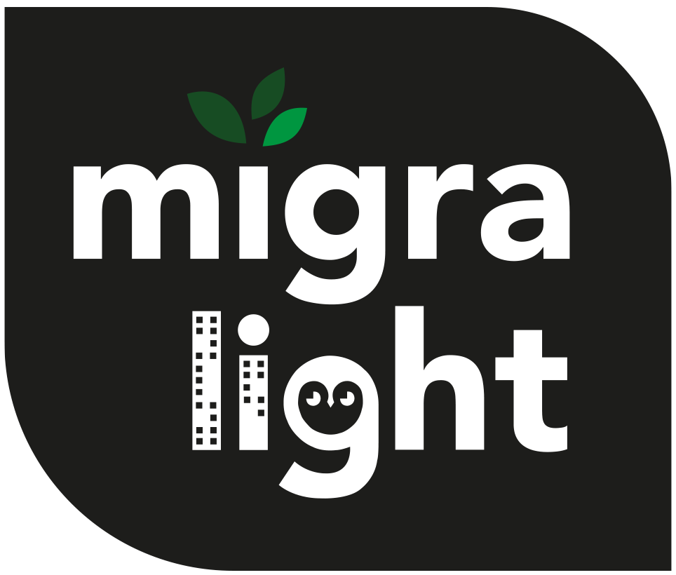
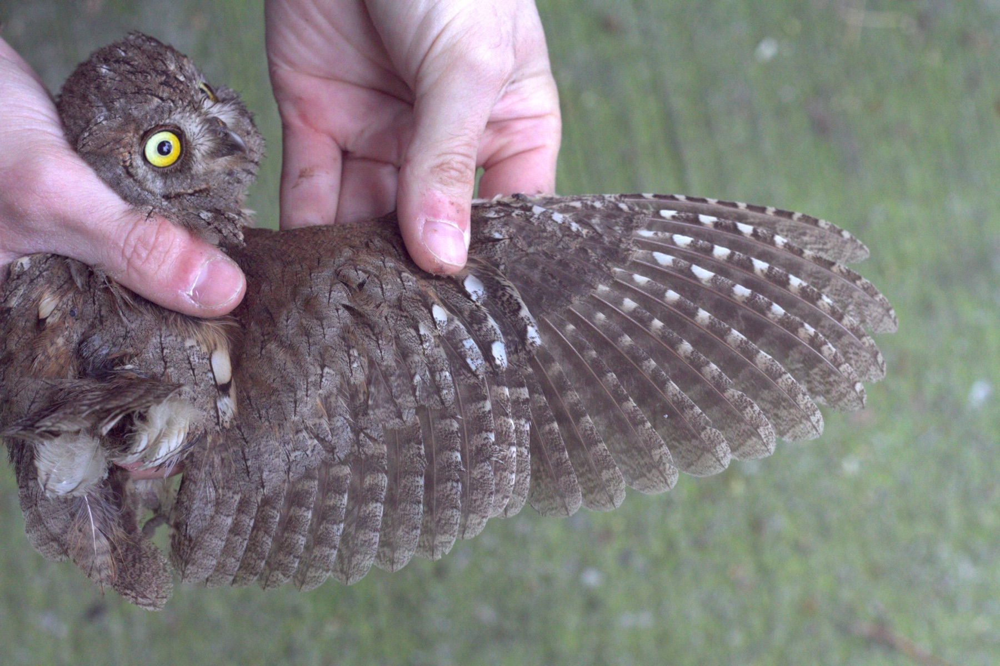
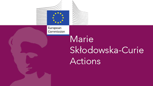
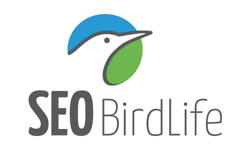

  

    
MIGRALIGHT · Ongoing project

    
Following scops owls across continents to understand how urbanisation and artificial light at night shape migration.

  

  

<figure class="editorial-feature editorial-feature--project">
  
</figure>

## The project

MIGRALIGHT investigates how human-induced environmental change affects long-distance animal migration and the evolutionary consequences of migratory change. We monitor scops owl (*Otus scops*) populations living in contrasting environments across a broad geographical range.

The project was launched with support from the Swiss Ornithological Institute and a Global Marie Skłodowska-Curie Action, and continues through an international network of researchers and conservation organisations.

  <article>
    01
    <h3>Compare</h3>
    
Identify differences in migratory behaviour between urban and non-urban populations.

  </article>
  <article>
    02
    <h3>Test</h3>
    
Measure the effects of artificial light at night across a broad geographical range.

  </article>
  <article>
    03
    <h3>Connect</h3>
    
Determine population structure and connectivity under contrasting anthropogenic pressures.

  </article>

## Why scops owls?

The Eurasian scops owl is one of Europe's smallest owls and its only long-distance migratory owl. It breeds around the Mediterranean and winters in sub-Saharan Africa. Its use of urban habitats and nest boxes makes it an exceptional study system for investigating how migratory behaviour changes in human-altered environments.

## Network and support

The project brings together scientific and public organisations across Europe. Partner details and the full collaboration map will be expanded as project information is consolidated.

  
  
  
  

<aside class="callout callout--dark">
  
Work with us

  <h2>Part of the scops owl research community?</h2>
  
We welcome conversations with researchers and organisations working on scops owls, migration, urban ecology or artificial light at night.

  <a class="text-arrow text-arrow--light" href="mailto:pacapilla@gmail.com">Get in touch →</a>
</aside>
