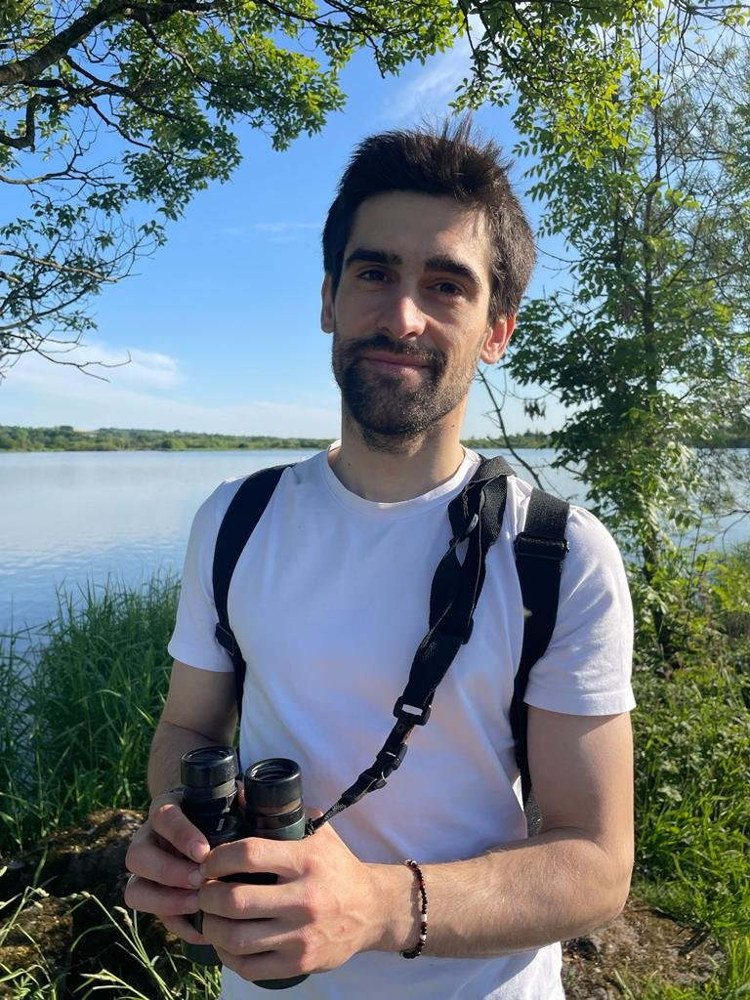
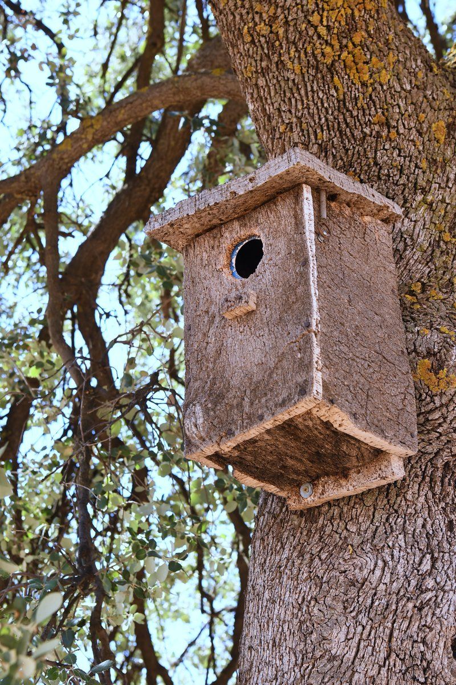
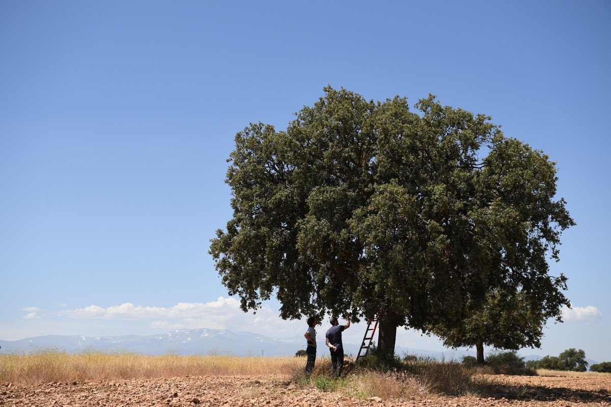
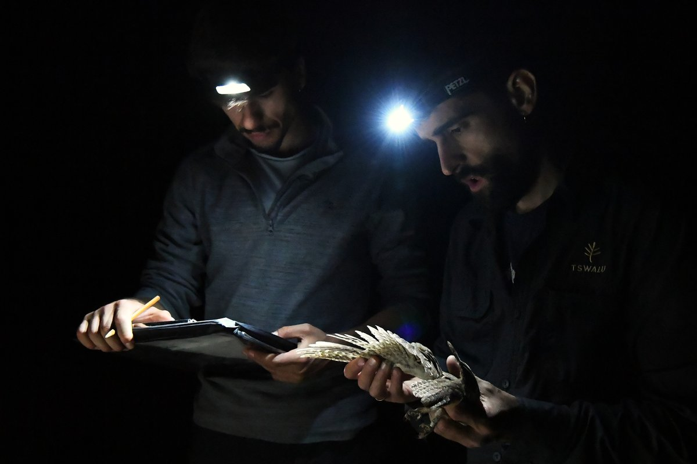

  
Evolutionary biologist

  

    
I am a Ramón y Cajal Fellow in the Biology Department and Global Change Research Institute at Rey Juan Carlos University, Madrid.

    
I study how animals respond and adapt to environmental change, primarily studying wild birds. Using human-altered environments as study systems, my research combines behaviour, ecology and evolution.

  

<figure class="about-gallery">
  

    
    
    
    
  

  <figcaption>Photographs 2–4 © Daniel Leopoldsberger.</figcaption>
</figure>

## Career

<ol class="timeline">
  <li>Sep 2026–present
<strong>Ramón y Cajal Fellow</strong>
Biology Department · Rey Juan Carlos University, Madrid, Spain.

</li>
  <li>Aug 2024–Aug 2026
<strong>Marie Skłodowska-Curie Global Fellow · MIGRALIGHT</strong>
Swiss Ornithological Institute, Switzerland · Doñana Biological Station-CSIC, Spain.

</li>
  <li>Apr–Jul 2024
<strong>Postdoctoral researcher</strong>
Bird Migration Unit · Swiss Ornithological Institute, Switzerland.

</li>
  <li>Oct 2019–Mar 2024
<strong>Postdoctoral researcher</strong>
University of Glasgow, UK.

</li>
  <li>2015–2019
<strong>PhD in Biological Sciences · Evolutionary biology</strong>
Centre for Ecology and Conservation · University of Exeter, UK.

</li>
  <li>2014–2015
<strong>MSc in Quantitative Methods in Biodiversity, Conservation and Epidemiology</strong>
University of Glasgow, UK.

</li>
  <li>2009–2013
<strong>BSc in Biology</strong>
Complutense University of Madrid, Spain.

</li>
</ol>

