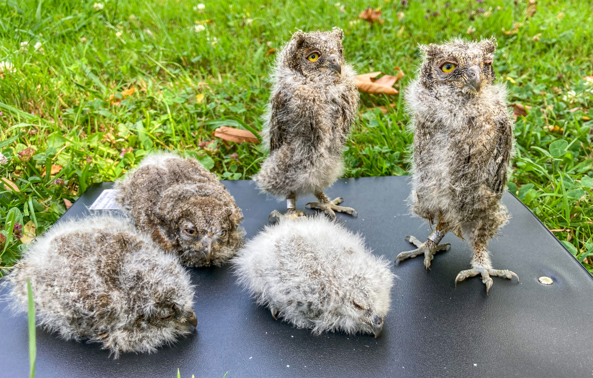

<section class="landing-hero" aria-labelledby="landing-title">
  
  
  

    
    
    
      
      
        
          
          
            
            
            
            
            
            
            
            
          
          
        
      
    
  

  

  

    

    <h1 id="landing-title">Behaviour, Ecology & Evolution in a human-altered world</h1>
    
We study animals in human-altered environments, integrating across disciplines, from behaviour and physiology to ecology and evolution.

    
Global Change Research Institute - Rey Juan Carlos University (Madrid, Spain)

    <a class="text-arrow text-arrow--light" href="/BeEcoEvo/">Explore the research →</a>
  

  
Photo: Daniel Leopoldsberger

</section>

