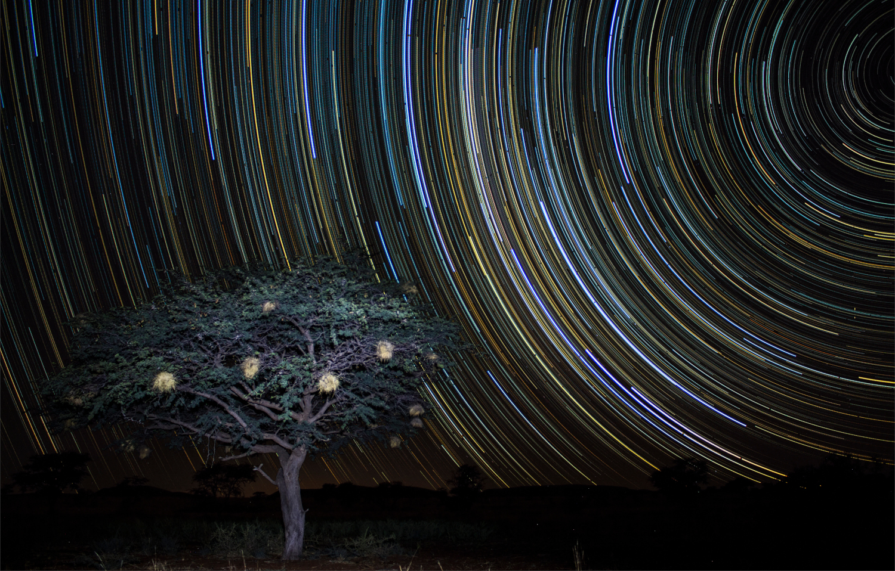
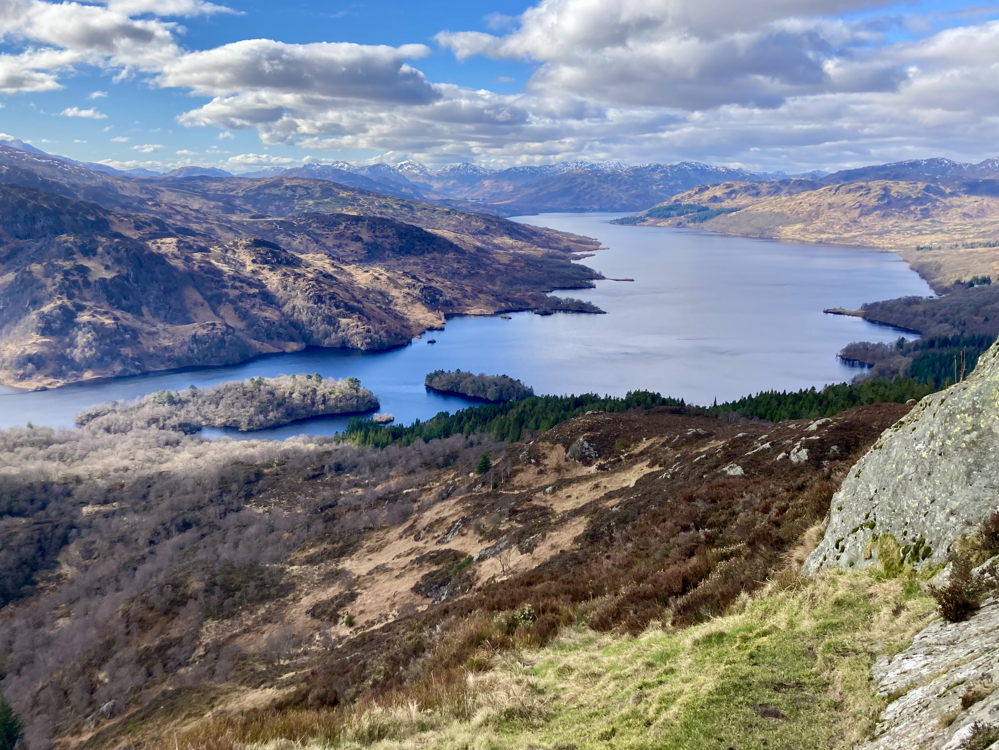

Human activity is rapidly transforming the environments in which animals live. Our research asks how animals respond to these changes, which mechanisms drive their responses, and what the ecological and evolutionary consequences are. We also investigate why individuals and populations differ in their responses and what those differences mean for ecology and evolution. This is a snapshot of what we do.

<section class="research-theme research-theme--split research-theme--reverse">
  

    
01 · Ecological drivers of animal responses in human-altered environments

    
We use correlational datasets and field experiments to unravel the ecological drivers of phenotypic variation in human-altered environments. We take advantage of variation in human-associated environmental factors, such as artificial light at night, across urban habitats to test core hypotheses in urban evolutionary ecology. By combining local experiments with global analyses, we connect local patterns and mechanisms to broader conclusions.

  

  
</section>

<section class="research-theme research-theme--split">
  

    
02 · The role of behaviour in adaptation to human-altered environments

    
Behaviour often responds rapidly to environmental change. Whether arising through phenotypic plasticity or microevolution, behavioural responses can provide a first route to adaptation in changing environments. Behaviour can also accelerate or slow the pace of evolution, making it an important driver of adaptive change. We currently use migration, a key eco-evolutionary trait, to test hypotheses about the role of behaviour in adaptation to human-altered environments. Our work focuses on long-distance bird migration, daily and seasonal biological rhythms. The ongoing <a href="/scops_owl_project/">Scops Owl Project</a> tracks migratory populations across Europe and urbanisation gradients to understand how life in human-altered environments affects movement, and its feedback to adaptation.

  

  
</section>

<section class="research-theme research-theme--split research-theme--reverse">
  

    
03 · Adaptation and evolutionary consequences

    
We build individual-based datasets that combine behaviour, life-history traits and reproductive output to estimate selection on traits that might underpin adaptation to human-altered environments. We also use genomics to identify genetic variation that is associated with these environments and that is potentially subject to selection within them.

  

  
</section>
